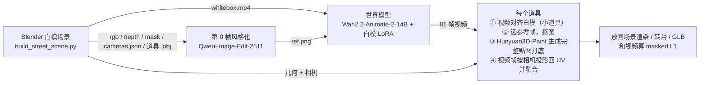

# whitebox2texture

**从白模视频到可用贴图**：先用 Blender 搭一个白模场景，渲染一段相机运动视频；再用世界模型把它生成成目标风格的视频（例如《双城之战》里的金克丝、蔚、凯特琳）；最后利用白模**已知的几何和相机**，把视频帧逐像素投影回每个道具的 UV（reproject），得到和视频外观一致的贴图。贴好的模型可以放回场景，也可以导出成 GLB。


*左：白模输入。中：世界模型生成的视频。右：白模场景中只把商店、木箱、木桶换成从视频投影回来的贴图，人物仍是白模。*

---

## 目录

- [流程](#流程)
- [结果](#结果)
- [环境要求](#环境要求)
- [安装](#安装)
- [复现 Arcane demo](#复现-arcane-demo)
- [输出说明](#输出说明)
- [哪些结果能逐位复现](#哪些结果能逐位复现)
- [换成自己的场景和角色](#换成自己的场景和角色)
- [脚本一览](#脚本一览)
- [早期实验：小屋 demo](#早期实验小屋-demo)
- [约定和已知限制](#约定和已知限制)
- [第三方组件与许可](#第三方组件与许可)

## 流程



对每个道具来说：

1. **对齐**（`align_object.py`，只用于小道具）：世界模型画的小物体会偏离白模 5–30 px。先用 GrabCut 在视频里把物体分割出来（以白模 mask 为种子），再用 ECC 拟合每帧的 2D 仿射（白模像素 → 视频像素）。拟合结果要过合理性检查，不合格的帧从前后的好帧插值，否则保持恒等。
2. **参考帧**（`make_ref.py`）：选物体最大、没被画面边缘切掉、也不挨着人物的一帧，抠出带 alpha 的正方形参考图，同时算出这一帧相机相对物体的方位角。
3. **Hunyuan3D-Paint 2.1**（`hy3d_texture.py`）：输入白模 mesh 和参考图，生成一张完整的贴图，背面这类视频里看不到的地方也有。
4. **投影**（`project_frames.py`）：取 11 帧，每个 texel 按已知相机投影到这些帧，用白模深度做遮挡测试，限定在腐蚀后的物体 mask 内，并排除人物周围 20 px。`VIEW_SELECT=patch` 让每个平面块只取一帧（最正对、对齐最好的那帧），避免多帧平均造成重影。被看到的 texel 用视频颜色；没被看到的保留 Hunyuan 的颜色，并做颜色统计匹配，接缝处羽化过渡。

## 结果


*每行一个角色。列依次为：白模渲染 | 世界模型视频 | 道具换成重投影贴图。*


*每个道具的 360° 转台，三张贴图分别是：只用 Hunyuan、只用视频投影、两者融合。*

下表是道具在原相机下重新渲染后，和视频在物体 mask 内的 L1 误差（0–255，越低越好）。`pipelines/arcane_demo.sh` 会生成同样一张表（`runs/l1_table.md`）：

| 角色 | 道具 | 只用 Hunyuan（lit） | + 视频投影（unlit） | 对齐后：Hunyuan / + 投影 | 被视频覆盖的 texel 比例 |
|---|---|---|---|---|---|
| Jinx | 商店 | 39.0 | **10.1** | – | 25% |
| Jinx | 木箱 | 19.9 | **12.4** | 19.2 / 13.1 | 33% |
| Jinx | 木桶 | 38.4 | **21.6** | 41.8 / 17.0 | 46% |
| Vi | 商店 | 44.2 | **14.6** | – | 25% |
| Vi | 木箱 | 32.5 | **29.6** | 33.9 / 27.9 | 33% |
| Vi | 木桶 | 23.9 | **16.7** | 20.8 / 14.1 | 46% |
| Caitlyn | 商店 | 28.2 | **14.9** | – | 25% |
| Caitlyn | 木箱 | 24.3 | **20.4** | 21.1 / 13.8 | 33% |
| Caitlyn | 木桶 | 33.0 | **23.1** | 24.1 / 20.9 | 46% |

Vi 的木箱提升很小，是因为世界模型在那里额外画了一堆箱子和蔬菜，和白模对不上。拿白模视频本身当"生成视频"跑一遍整条流程（dry run），三个道具融合后的 L1 分别是 3.6 / 2.7 / 1.6，说明坐标链路本身是对的，剩下的误差主要来自生成视频和白模不一致。

## 环境要求

- Linux x86_64 + NVIDIA GPU。参考机器是 8×H200 141 GB，驱动 595.71.05。每一步都只用单卡，世界模型实测占用约 43 GB 显存（自带 CPU offload）。显存不够跑 Qwen 时可以设 `IMGEDIT_OFFLOAD=1`。
- **不需要 root**：所有东西都装在 `$W2T_HOME`（默认 `./workspace`）下面，不改系统 CUDA、PATH 或 shell 配置。conda 只用 `conda-forge` 和 `nvidia` 频道。
- 一个 `conda`（Miniconda 即可），外加 `git` 和 `curl`。
- 磁盘约 150 GB：

| 组件 | 大小 | 用途 |
|---|---|---|
| Blender 4.5.14 LTS | 1.2 GB | 白模搭建、渲染、GLB 导出 |
| env `hy3d` + CUDA 12.4 toolkit 前缀 | 6.4 + 6.2 GB | Hunyuan3D-Paint，以及所有 CPU 侧步骤 |
| Hunyuan3D-2.1 paint + DINOv2-giant + RealESRGAN | 15 GB | 贴图生成 |
| env `wananimate` + Wan2.2-Animate-2-14B | 7.3 + 47 GB | 世界模型 |
| GameRender 推理包（白模 LoRA） | 0.1 GB | 世界模型。**内部包，未公开**，见下文 |
| env `imgedit` + Qwen-Image-Edit-2511（可选） | 7.2 + 54 GB | 只有重新生成第 0 帧时才需要 |

## 安装

```bash
git clone <this repo> whitebox2texture && cd whitebox2texture

# 可选：机器上已经装过某些组件时，指向已有路径
cp config.local.sh.example config.local.sh && vim config.local.sh

bash install/00_blender.sh    # 官方 tarball，sha256 校验
bash install/01_hy3d.sh       # 环境 + Hunyuan3D-2.1（固定 commit 82920d6）+ 编译两个 CUDA 扩展 + 权重
bash install/02_imgedit.sh    # 可选：Qwen-Image-Edit-2511
# 先把 GameRender 推理包解压到 workspace/third_party/gamerender-whitebox-bidirectional-inference（或在 config.local.sh 里设 GAMERENDER_REPO）
bash install/03_wan.sh        # 环境 + Wan2.2-Animate-2-14B 权重
bash install/check.sh         # 逐项检查，全部 ok 才往下走
```

- 所有路径都集中在 `config.sh`，每一项都可以用环境变量或 `config.local.sh` 覆盖。
- `install/lock/*.txt` 是参考环境的 `pip freeze`，安装脚本按这些精确版本安装。
- **世界模型**用的是 GameRender 项目的推理包 `gamerender-whitebox-bidirectional-inference`（Wan2.2-Animate-2-14B 双向注意力底座，加上在"白模→渲染"配对数据上训练的 rank-32 LoRA `animate2_base_scene00/step-2000`）。这个包没有公开，需要向 GameRender 团队索取。也可以换成任何"白模视频 + 第 0 帧 → 风格视频"的模型，只要输出 `<style>/video/<name>_gen.mp4`（81 帧，832×480，和白模逐帧对齐）。后面的步骤只依赖这个文件。
- `03_wan.sh` 会从 `Wan-AI/Wan2.2-Animate-14B` 额外下载一个 `Wan2.1_VAE.pth`。原因是 Animate-2 仓库里自带的 `vae.pth` 不是 GameRender loader 要的那个文件，DiffSynth 按哈希识别模型，用错了会报 `Cannot detect the model type`。

## 复现 Arcane demo

```bash
pipelines/arcane_demo.sh 0 1 2     # 三个角色各占一张卡并行；只给一张卡就依次跑
```

参考机器（H200）上每个角色的耗时：

| 阶段 | 做什么 | 耗时 |
|---|---|---|
| `scene` | Blender 搭白模广场：跑动的人偶 + 跟拍相机（左右摆动 ±20°）+ 商店、木箱、木桶；81 帧，832×480，15 fps | ~1 min |
| `edit` | Qwen-Image-Edit 把白模第 0 帧画成 Arcane 风格，seed 1–4 各出一张候选 | ~3 min |
| `video` | 世界模型：40 步，cfg 3，seed 0 | ~10 min |
| `texture` | 三个道具依次跑 对齐 → 参考帧 → Hunyuan（每个约 1 min）→ 投影；然后渲染、转台、L1 | ~30 min |
| `compose` | `arcane_3x3.mp4`、每个角色一个 GLB、`l1_table.md` | ~1 min |

常用变量：

```bash
STYLES="jinx" pipelines/arcane_demo.sh 0                 # 只跑一个角色
STAGES="texture compose" pipelines/arcane_demo.sh 0 1 2  # 只重跑后半段（前面的输出已经在 runs/ 里）
REF=seed pipelines/arcane_demo.sh 0 1 2                  # 用重新生成的 Qwen 候选（按记录的 seed）当第 0 帧
CYCLES_DEVICE=CPU BLENDER_THREADS=32 ...                 # 没有 RTX/OptiX 时用 CPU 渲染（慢，但结果一致）
RUNS=/data/w2t_runs ...                                  # 换输出目录
```

- **第 0 帧的选择**：每个角色生成了 4 个候选，最终用的是 Jinx seed 1、Vi seed 1、Caitlyn seed 4（记录在 `configs/street/<style>/seed`）。这些选中的帧也直接放在了 `configs/street/<style>/ref.png` 里。默认 `REF=shipped` 就用这几张，这样后面所有步骤的输入和原实验完全相同。`edit` 阶段照样会重新生成候选，方便对比。
  

  *白模第 0 帧和三个选中的风格化第 0 帧。*

- **prompt**：图像编辑用 `configs/street/<style>/edit_prompt.txt`，世界模型用 `prompt_video.txt`，格式是"人物外观描述：…\n背景描述：…"，和 GameRender 训练数据一致。世界模型的参考 prompt 写在 `arcane_demo.sh` 里，是 `白盒渲染的游戏画面，完整呈现场景的几何布局与遮挡关系，画面中的角色在移动，相机视角持续变化。`

## 输出说明

```
runs/
├── street_v1/                    白模场景
│   ├── rgb/####.png  depth/####.exr（平面深度）  mask_{shop,crates,barrel,character}/####.png
│   ├── cameras.json              每帧 c2w（Blender 相机，看向 -Z）+ 针孔内参
│   ├── shop.obj crates.obj barrel.obj   世界坐标，带 UV
│   ├── scene.blend  whitebox.mp4
├── arcane_<style>/
│   ├── edit/candidate_seed{1..4}.png    ref.png（给世界模型的第 0 帧）
│   ├── video/street_gen.mp4             世界模型输出
│   ├── tex_<prop>/
│   │   ├── frames/  silhouette/  align.json        视频帧，以及对齐结果（小道具）
│   │   ├── ref_rgba.png  ref.json                  Hunyuan 参考图、选中的帧和方位角
│   │   ├── hunyuan/textured_world.obj  textured_hunyuan.jpg   Hunyuan 贴图（mesh 已转回世界坐标）
│   │   ├── proj/albedo_fused.png       ← 最终贴图（用 textured_world.obj 的 UV）
│   │   ├── proj/albedo_projected.png  coverage.png  stats.json
│   │   └── eval_l1.json
│   └── render/                          {fused_unlit, hunyuan_lit}_{original, orbit}/  turntable_<prop>_{hunyuan, projected, fused}/
├── arcane_3x3.mp4   arcane_<style>_props.glb   l1_table.md
```

## 哪些结果能逐位复现

| 步骤 | 确定性 |
|---|---|
| 白模场景（几何、相机、mask、深度） | 确定。用 CPU 重新渲染（原实验用的是 GPU OptiX）后，`cameras.json` 和三个 `.obj` 逐字节相同；8000 多万个 mask/深度像素中只有十几个边缘像素不同；RGB 最大差 2/255 |
| 对齐、选参考帧、投影、L1 | 确定（纯 CPU，OpenCV/NumPy） |
| Qwen 第 0 帧 | 固定 seed，但 bf16 扩散在不同 GPU、驱动、库版本下不能保证逐位一致，所以默认直接用仓库里的 `ref.png` |
| 世界模型、Hunyuan3D-Paint | 固定 seed（0）。同样的硬件和版本下结果应该一致；换了硬件或版本会有小差异，L1 数字应该接近，但不会逐位相同 |

## 换成自己的场景和角色

- **新角色/风格**：复制 `configs/street/jinx` 改两个 prompt，然后跑 `STYLES=<新目录名> REF=seed pipelines/arcane_demo.sh <GPU>`。先只跑 `STAGES="edit"`，看过 `runs/arcane_<name>/edit/` 里的候选后，把中意的 seed 写进 `seed` 文件，再跑后面的阶段。
- **第 0 帧里道具要大**：图像编辑模型会忽略远处很小的道具，还会在前景自己编出箱子、桶。所以 prompt 要写明位置和数量，例如 "…becomes, in exactly that place and size, …"、"Do not add any extra crates, barrels or props anywhere else"。
- **新道具**：在 `build_street_scene.py` 的 `ASSETS` 里给它一个 `pass_index`，脚本会自动导出 `<name>.obj` 和 `mask_<name>/`。然后在 `run_street.sh` 的 `ASSETS` 里加上它。大物体（画面里位置基本不漂）设 `ALIGN=0`，小物体保留对齐。
- **覆盖率**：只有视频里看到过的面才会拿到视频颜色（这里是 25–46%），其余是颜色匹配过的 Hunyuan 贴图。要提高覆盖率，最直接的办法是让相机绕道具走一圈。
- **光照**：投影出来的贴图里带着视频的光照，所以和视频对比时用 unlit（emission）渲染。要在新光照下使用，还需要一步去光照（delighting），本仓库没有做。

## 脚本一览

| 脚本 | 环境 | 作用 |
|---|---|---|
| `pipelines/arcane_demo.sh` | – | Arcane demo 端到端 |
| `pipelines/house_demo.sh` | – | 小屋 demo 端到端 |
| `scripts/build_street_scene.py` / `build_scene.py` | Blender | 搭白模、渲染 rgb/depth/mask、导出相机和 mesh |
| `scripts/export_object.py` | Blender | 从已有场景再导出一个物体的 mesh 和 mask（如小屋场景的 Crate） |
| `scripts/encode_video.py` | hy3d | PNG 序列 → H.264 |
| `scripts/edit_image.py` | imgedit | Qwen-Image-Edit-2511 第 0 帧风格化 |
| `scripts/paste_region.py` | hy3d | 只把编辑结果贴回某个物体的区域（用于小屋变体） |
| `scripts/run_world_model.sh` | wananimate | 世界模型推理 |
| `scripts/run_street.sh` | – | 一个风格的所有道具：贴图 + 渲染 + 转台 + L1 |
| `scripts/run_texture.sh` | – | 单个物体：对齐 → 参考帧 → Hunyuan → 投影 [→ 渲染 + L1] |
| `scripts/align_object.py` | hy3d | 视频 ↔ 白模逐帧 2D 仿射对齐 |
| `scripts/make_ref.py` | hy3d | 拆帧，选参考帧，抠图 |
| `scripts/hy3d_texture.py` | hy3d | 调用 Hunyuan3D-Paint，负责坐标系换算 |
| `scripts/project_frames.py` | hy3d | 视频帧 → UV 投影与融合 |
| `scripts/render_assets.py` / `render_textured.py` / `render_all.sh` | Blender | 把贴好的模型放回白模场景渲染（原相机 / 环绕） |
| `scripts/render_turntable.py` | Blender | 单个道具 360° 转台 |
| `scripts/eval_l1.py` / `summarize_l1.py` | hy3d | masked L1 和汇总表 |
| `scripts/compose_grid.py` | hy3d | 多路视频拼成带标签的网格 |
| `scripts/export_glb.py` / `export_props_glb.py` | Blender | 导出 GLB（UE 和任何 glTF 查看器都能打开） |

以上环境变量都有默认值：`OBJECT`（处理哪个物体，默认 `house`）、`VIEW_SELECT`、`REF_FRAME`、`ALIGN`、`FRAMES`、`NO_RENDER`、`REUSE_HUNYUAN`、`FRAME_STEP`。具体含义写在各脚本开头的注释里。

## 早期实验：小屋 demo

这是更早的单物体测试：一个白模小屋加一个木箱，相机在小屋正面扫过约 110°。做了三个只改小屋外观的第 0 帧变体（奶油色、红砖、石头）。红砖和石头是在奶油色帧上再编辑一次，然后只把小屋区域贴回去，所以画面里其他像素完全相同。

```bash
pipelines/house_demo.sh 0 1 2
```

| 变体 | 物体 | 只用 Hunyuan（lit） | + 视频投影（unlit） | 对齐后 |
|---|---|---|---|---|
| cream | 小屋 | 51.3 | **15.8** | – |
| cream | 木箱 | 28.0 | 26.6 | 26.3 / **18.9** |
| brick | 小屋 | 43.3 | **16.4** | – |
| stone | 小屋 | 46.6 | **13.6** | – |

第 0 帧的 seed：奶油色 2，红砖 1，石头 1；贴回时 mask 膨胀 24 px。木箱这一行说明了为什么要做对齐：世界模型画的木箱和白模错开了 5–30 px，不对齐时投影几乎没有帮助。

## 约定和已知限制

- Blender 世界坐标 Z 轴朝上，单位米。`cameras.json` 存的是 Blender 的 c2w（相机看向 -Z）和针孔内参 K；深度 EXR 是平面深度（沿光轴）。
- Hunyuan 的输入是 glTF 的 Y 轴朝上坐标系。它的 azim 0 相当于从 Blender 的 -Y 方向看过来，azim 增大时朝 +X 转。所以 `YAW = -theta(参考帧)` 会把参考视角放到 Hunyuan 的正面相机上。Hunyuan 总是用 xatlas 重新展 UV；`use_remesh=False` 时输出 mesh 会回到输入坐标系。
- 白模小屋的屋顶表达不了茅草的厚度。全局颜色匹配会把没被看到的面往视频主色调拉，例如石屋背面偏黄绿。

## 第三方组件与许可

本仓库只包含胶水代码、prompt 和几张示例图，不包含任何模型权重。各组件按各自的许可使用：

- [Blender](https://www.blender.org/)：GPL。
- [Hunyuan3D-2.1](https://github.com/Tencent-Hunyuan/Hunyuan3D-2.1)：Tencent Hunyuan 3D 2.1 Community License，**不适用于欧盟、英国和韩国**。
- [Wan2.2-Animate-2-14B](https://huggingface.co/Wan-AI/Wan2.2-Animate-2-14B) 和 [Qwen-Image-Edit-2511](https://huggingface.co/Qwen/Qwen-Image-Edit-2511)：使用前请查看各自模型卡上的许可。
- GameRender 白模 LoRA：内部权重，不随本仓库分发。
- 金克丝、蔚、凯特琳和《双城之战》/《英雄联盟》是 Riot Games 的 IP，这里只作为风格测试的 prompt。
