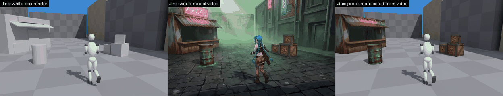
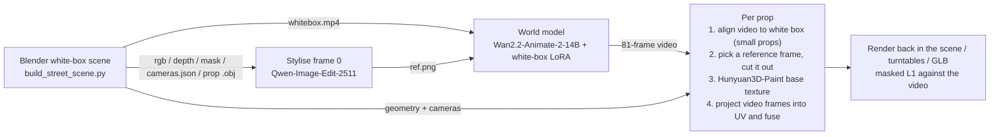
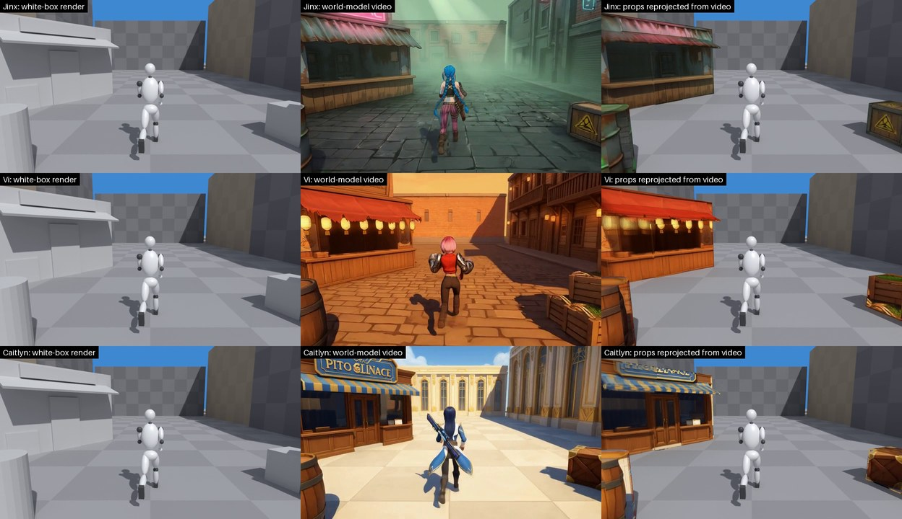
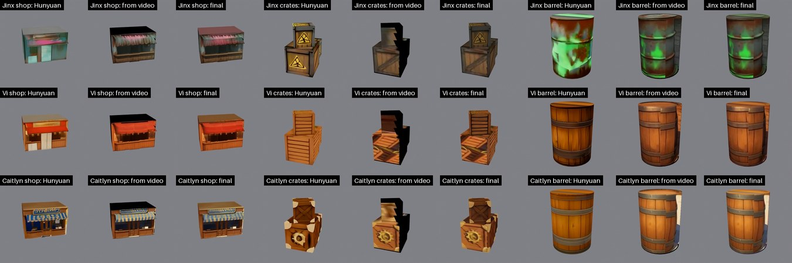
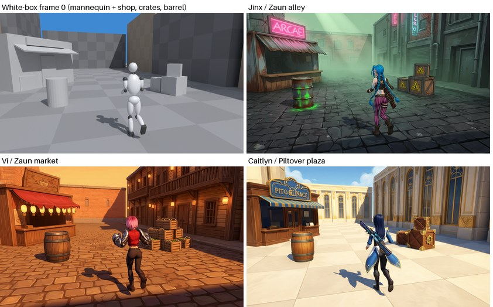

# whitebox2texture

**From a white-box video to usable textures.** Build a white-box scene in Blender and render a camera-motion video. A world model turns it into a video in a target style, for example Jinx, Vi and Caitlyn from *Arcane*. Because the white box's **geometry and cameras are known**, every video frame can then be projected pixel by pixel back into each prop's UV space (reprojection). The result is a texture whose look matches the video. The textured models can go back into the scene or be exported as GLB.



*Left: white-box input. Middle: world-model video. Right: the white-box scene with only the shop, crates and barrel swapped for textures reprojected from the video; the character is still the white-box mannequin.*

---

## Contents

- [Pipeline](#pipeline)
- [Results](#results)
- [Requirements](#requirements)
- [Installation](#installation)
- [Reproducing the Arcane demo](#reproducing-the-arcane-demo)
- [Outputs](#outputs)
- [What reproduces bit for bit](#what-reproduces-bit-for-bit)
- [Using your own scene and characters](#using-your-own-scene-and-characters)
- [Scripts](#scripts)
- [Earlier experiment: the house demo](#earlier-experiment-the-house-demo)
- [Conventions and known limitations](#conventions-and-known-limitations)
- [Third-party components and licenses](#third-party-components-and-licenses)

## Pipeline



For each prop:

1. **Alignment** (`align_object.py`, small props only). The world model draws small objects 5–30 px away from where the white box puts them. GrabCut segments the object in the video, seeded with the white-box mask, and ECC then fits a 2D affine per frame (white-box pixel → video pixel). Each fit has to pass plausibility checks. Frames that fail are interpolated from the good frames around them; if there are none, the transform stays at identity.
2. **Reference frame** (`make_ref.py`). Picks the frame where the object is largest, not clipped by the image border, and clear of the character. It cuts out a square reference image with alpha and computes the camera's azimuth relative to the object in that frame.
3. **Hunyuan3D-Paint 2.1** (`hy3d_texture.py`). Takes the white-box mesh and the reference image and generates a complete texture, including the back and other faces the video never shows.
4. **Projection** (`project_frames.py`). Every texel is projected into 11 frames with the known cameras and depth-tested against the white-box depth. Samples must fall inside the eroded object mask and more than 20 px from the character. With `VIEW_SELECT=patch`, each planar patch takes a single frame (the most frontal, best-aligned one), which avoids the ghosting that averaging several frames causes. Texels the video sees take the video colour. The rest keep Hunyuan's colour after a colour-statistics match, with a feathered blend at the seams.

## Results



*One row per character. Columns: white-box render | world-model video | props swapped for reprojected textures.*



*A 360° turntable of each prop with three textures: Hunyuan only, video projection only, and the two fused.*

The table gives the L1 error (0–255, lower is better) between the video and the props re-rendered from the original cameras, measured inside the object mask. `pipelines/arcane_demo.sh` writes the same table to `runs/l1_table.md`:

| Character | Prop | Hunyuan only (lit) | + video projection (unlit) | Aligned: Hunyuan / + projection | Texels covered by the video |
|---|---|---|---|---|---|
| Jinx | shop | 39.0 | **10.1** | – | 25% |
| Jinx | crates | 19.9 | **12.4** | 19.2 / 13.1 | 33% |
| Jinx | barrel | 38.4 | **21.6** | 41.8 / 17.0 | 46% |
| Vi | shop | 44.2 | **14.6** | – | 25% |
| Vi | crates | 32.5 | **29.6** | 33.9 / 27.9 | 33% |
| Vi | barrel | 23.9 | **16.7** | 20.8 / 14.1 | 46% |
| Caitlyn | shop | 28.2 | **14.9** | – | 25% |
| Caitlyn | crates | 24.3 | **20.4** | 21.1 / 13.8 | 33% |
| Caitlyn | barrel | 33.0 | **23.1** | 24.1 / 20.9 | 46% |

Vi's crates barely improve because the world model painted an extra pile of crates and vegetables there that the white box does not have. As a dry run, the whole pipeline was also run with the white-box video itself standing in for the generated video. The fused L1 for the three props was 3.6 / 2.7 / 1.6, which shows the coordinate chain is correct. The remaining error comes mostly from the generated video disagreeing with the white box.

## Requirements

- Linux x86_64 with an NVIDIA GPU and a driver for CUDA 12.8 or newer (R570+). The reference machine has 8×H200 141 GB and driver 595.71.05. Every step uses a single GPU. The world model was measured at about 43 GB of VRAM (it has its own CPU offload). If Qwen does not fit in your VRAM, set `IMGEDIT_OFFLOAD=1`.
- **No root needed.** Everything is installed under `$W2T_HOME` (default `./workspace`). The system CUDA, PATH and shell profile are never touched. Conda uses only the `conda-forge` and `nvidia` channels.
- Already on the machine: `git`, `curl`, `tar`/`xz`, and `g++` 13 or older (to compile Hunyuan's CUDA extensions against the CUDA 12.4 toolkit the installer brings). Blender also needs the usual X11/GL client libraries, even headless; `install/01_blender.sh` names the packages if any are missing. Conda is optional: without one, the installer puts Miniforge in `$W2T_HOME/conda`.
- About 85 GB of disk, or 150 GB with the optional Qwen-Image-Edit:

| Component | Size | Used for |
|---|---|---|
| Blender 4.5.14 LTS | 1.2 GB | building the white box, rendering, GLB export |
| env `hy3d` + CUDA 12.4 toolkit prefix | 6.4 + 6.2 GB | Hunyuan3D-Paint and every CPU-side step |
| Hunyuan3D-2.1 paint + DINOv2-giant + RealESRGAN | 15 GB | texture generation |
| env `wananimate` + Wan2.2-Animate-2-14B | 7.3 + 47 GB | world model |
| GameRender inference package (white-box LoRA + code) | 0.1 GB | world model. **Internal**; ships in `third_party/`, see below |
| env `imgedit` + Qwen-Image-Edit-2511 (optional) | 7.2 + 54 GB | only needed to regenerate frame 0 |

## Installation

```bash
git clone https://github.com/TeaWhiteBro/whitebox2texture.git && cd whitebox2texture
bash install/all.sh           # ~10 min on the reference machine, mostly ~75 GB of downloads; ends with "all required components ok"
```

`install/all.sh` checks the prerequisites above and then runs these steps (each can also be run on its own):

| Script | What it installs |
|---|---|
| `install/00_conda.sh` | nothing if a `conda` is found; otherwise Miniforge 26.7.2 (sha256-checked) into `$W2T_HOME/conda` |
| `install/01_blender.sh` | Blender 4.5.14 LTS, official tarball, sha256-checked |
| `install/02_hy3d.sh` | env `hy3d`, Hunyuan3D-2.1 pinned to commit 82920d6, its two CUDA extensions, Hunyuan/DINOv2/RealESRGAN weights |
| `install/03_wan.sh` | env `wananimate`, the shipped GameRender package's DiffSynth-Studio, Wan2.2-Animate-2-14B weights |
| `install/04_imgedit.sh` | only with `WITH_IMGEDIT=1`: env `imgedit` and Qwen-Image-Edit-2511, needed only for `REF=seed` |
| `install/check.sh` | checks every component, downloads nothing |

This was tested from a fresh clone in an empty environment (new `HOME`, no conda on `PATH`, no Hugging Face token): Miniforge, both envs and every weight installed, and `check.sh` passed. Rerunning `all.sh` skips what is already there (2.5 min).

- All paths live in `config.sh`. Each one can be overridden by an environment variable or in `config.local.sh` (see `config.local.sh.example`), e.g. to reuse components that are already installed.
- `install/lock/*.txt` are `pip freeze` dumps of the reference environments, and the install scripts install those exact versions; the Python versions are pinned too.
- Every download is public and anonymous (download.blender.org, GitHub, PyPI, download.pytorch.org, conda-forge, Hugging Face). No account or token is needed.
- **The world model** is the GameRender project's inference package `gamerender-whitebox-bidirectional-inference`: a Wan2.2-Animate-2-14B bidirectional-attention base plus a rank-32 LoRA, `animate2_base_scene00/step-2000` (sha256 `28008ee7…fc1790`), trained on paired white-box → render data. It is internal and ships unmodified in `third_party/` (without the base model, which `03_wan.sh` downloads). Any other "white-box video + frame 0 → styled video" model works as a replacement, as long as it writes `<style>/video/<name>_gen.mp4` (81 frames, 832×480, frame-aligned with the white box). Every later step depends only on that file.
- `03_wan.sh` also downloads `Wan2.1_VAE.pth` from `Wan-AI/Wan2.2-Animate-14B`. The `vae.pth` shipped in the Animate-2 repo is not the file the GameRender loader expects. DiffSynth identifies models by hash, and the wrong file fails with `Cannot detect the model type`.

## Reproducing the Arcane demo

```bash
pipelines/arcane_demo.sh 0 1 2     # one GPU per character in parallel; with a single GPU they run one after another
```

Time per character on the reference machine (H200):

| Stage | What it does | Time |
|---|---|---|
| `scene` | Blender builds the white-box plaza: a running mannequin, a following camera (swinging ±20°), and the shop, crates and barrel; 81 frames, 832×480, 15 fps | ~1 min |
| `edit` | Qwen-Image-Edit paints white-box frame 0 in the Arcane style, one candidate for each of seeds 1–4 | ~3 min |
| `video` | world model: 40 steps, cfg 3, seed 0 | ~10 min |
| `texture` | for each of the three props: align → reference frame → Hunyuan (about 1 min each) → projection; then renders, turntables, L1 | ~30 min |
| `compose` | `arcane_3x3.mp4`, one GLB per character, `l1_table.md` | ~1 min |

Common variables:

```bash
STYLES="jinx" pipelines/arcane_demo.sh 0                 # a single character
STAGES="texture compose" pipelines/arcane_demo.sh 0 1 2  # rerun only the second half (earlier outputs already in runs/)
REF=seed pipelines/arcane_demo.sh 0 1 2                  # use the regenerated Qwen candidate (recorded seed) as frame 0
CYCLES_DEVICE=CPU BLENDER_THREADS=32 ...                 # render on CPU when there is no RTX/OptiX (slow, same result)
RUNS=/data/w2t_runs ...                                  # a different output directory
```

- **Choosing frame 0.** Each character got 4 candidates. The ones used are Jinx seed 1, Vi seed 1 and Caitlyn seed 4, recorded in `configs/street/<style>/seed`. The chosen frames also ship as `configs/street/<style>/ref.png`. The default `REF=shipped` uses them, so every later step sees exactly the inputs of the original experiment. The `edit` stage still regenerates the candidates for comparison.
  

  *White-box frame 0 and the three chosen stylised frames 0.*

- **Prompts.** The image edit uses `configs/street/<style>/edit_prompt.txt` (English). The world model takes two prompts. Both are in Chinese, following the prompt format of Wan2.2-Animate-2-14B's official examples and the GameRender README, and they are kept verbatim so the results reproduce:
  - `prompt_video.txt` uses the "character appearance: … / background: …" format.
  - `configs/street/prompt_ref.txt` describes the white-box reference video and is copied into each run directory. The house demo uses `configs/prompt_ref.txt`, which drops the moving character.

  Every Chinese prompt has an English translation next to it (`*.en.txt`), for reference only; the pipeline never reads them.

## Outputs

```
runs/
├── street_v1/                    white-box scene
│   ├── rgb/####.png  depth/####.exr (planar depth)  mask_{shop,crates,barrel,character}/####.png
│   ├── cameras.json              per-frame c2w (Blender camera, looks down -Z) + pinhole intrinsics
│   ├── shop.obj crates.obj barrel.obj   world coordinates, with UVs
│   ├── scene.blend  whitebox.mp4
├── arcane_<style>/
│   ├── edit/candidate_seed{1..4}.png    ref.png (frame 0 given to the world model)
│   ├── prompt_video.txt  prompt_ref.txt  edit_prompt.txt
│   ├── video/street_gen.mp4             world-model output
│   ├── tex_<prop>/
│   │   ├── frames/  silhouette/  align.json        video frames and the alignment result (small props)
│   │   ├── ref_rgba.png  ref.json                  Hunyuan reference image, chosen frame and azimuth
│   │   ├── hunyuan/textured_world.obj  textured_hunyuan.jpg   Hunyuan texture (mesh moved back to world coordinates)
│   │   ├── proj/albedo_fused.png       ← final texture (uses the UVs of textured_world.obj)
│   │   ├── proj/albedo_projected.png  coverage.png  stats.json
│   │   └── eval_l1.json
│   └── render/                          {fused_unlit, hunyuan_lit}_{original, orbit}/  turntable_<prop>_{hunyuan, projected, fused}/
├── arcane_3x3.mp4   arcane_<style>_props.glb   l1_table.md
```

## What reproduces bit for bit

| Step | Determinism |
|---|---|
| White-box scene (geometry, cameras, masks, depth) | Deterministic. Re-rendered on CPU (the original used GPU OptiX), `cameras.json` and the three `.obj` files are byte-identical; out of more than 80 million mask/depth pixels only a dozen or so edge pixels differ; RGB differs by at most 2/255 |
| Alignment, reference frame, projection, L1 | Deterministic (CPU only, OpenCV/NumPy) |
| Qwen frame 0 | Fixed seed, but bf16 diffusion is not guaranteed to be bit-exact across GPUs, drivers and library versions, so by default the `ref.png` shipped in the repo is used |
| World model, Hunyuan3D-Paint | Fixed seed (0). Results should match on the same hardware and versions; other hardware or versions give small differences, so the L1 numbers should come out close but not bit-identical |

## Using your own scene and characters

- **A new character or style.** Copy `configs/street/jinx`, edit the two prompts, then run `STYLES=<new dir name> REF=seed pipelines/arcane_demo.sh <GPU>`. Run `STAGES="edit"` alone first, look at the candidates in `runs/arcane_<name>/edit/`, write the seed you like into the `seed` file, then run the remaining stages.
- **Props must be large in frame 0.** The image-edit model ignores small, distant props and invents its own crates and barrels in the foreground. Spell out position and count in the prompt, e.g. "…becomes, in exactly that place and size, …" and "Do not add any extra crates, barrels or props anywhere else".
- **A new prop.** Give it a `pass_index` in `ASSETS` in `build_street_scene.py`; the script then exports `<name>.obj` and `mask_<name>/` automatically. Add it to `ASSETS` in `run_street.sh` as well. Set `ALIGN=0` for large objects whose position barely drifts in the video, and keep alignment on for small ones.
- **Coverage.** Only faces the video has seen get video colours (25–46% here); the rest is the colour-matched Hunyuan texture. The most direct way to raise coverage is to move the camera all the way around the prop.
- **Lighting.** The projected textures carry the video's lighting, which is why they are rendered unlit (emission) when compared with the video. Using them under new lighting needs a delighting step, which this repo does not do.

## Scripts

| Script | Env | Purpose |
|---|---|---|
| `pipelines/arcane_demo.sh` | – | Arcane demo end to end |
| `pipelines/house_demo.sh` | – | house demo end to end |
| `scripts/build_street_scene.py` / `build_scene.py` | Blender | build the white box, render rgb/depth/mask, export cameras and meshes |
| `scripts/export_object.py` | Blender | export one more object's mesh and mask from an existing scene (e.g. the Crate in the house scene) |
| `scripts/encode_video.py` | hy3d | PNG sequence → H.264 |
| `scripts/edit_image.py` | imgedit | stylise frame 0 with Qwen-Image-Edit-2511 |
| `scripts/paste_region.py` | hy3d | paste an edit back only inside one object's region (used for the house variants) |
| `scripts/run_world_model.sh` | wananimate | world-model inference |
| `scripts/run_street.sh` | – | all props of one style: textures + renders + turntables + L1 |
| `scripts/run_texture.sh` | – | one object: align → reference frame → Hunyuan → projection [→ render + L1] |
| `scripts/align_object.py` | hy3d | per-frame 2D affine alignment, video ↔ white box |
| `scripts/make_ref.py` | hy3d | extract frames, pick the reference frame, cut it out |
| `scripts/hy3d_texture.py` | hy3d | call Hunyuan3D-Paint and handle the coordinate conversions |
| `scripts/project_frames.py` | hy3d | video frames → UV projection and fusion |
| `scripts/render_assets.py` / `render_textured.py` / `render_all.sh` | Blender | render the textured models back in the white-box scene (original cameras / orbit) |
| `scripts/render_turntable.py` | Blender | 360° turntable of one prop |
| `scripts/eval_l1.py` / `summarize_l1.py` | hy3d | masked L1 and the summary table |
| `scripts/compose_grid.py` | hy3d | tile several videos into a labelled grid |
| `scripts/export_glb.py` / `export_props_glb.py` | Blender | GLB export (opens in UE and any glTF viewer) |

These environment variables all have defaults: `OBJECT` (which object to process, default `house`), `VIEW_SELECT`, `REF_FRAME`, `ALIGN`, `FRAMES`, `NO_RENDER`, `REUSE_HUNYUAN`, `FRAME_STEP`. The comment at the top of each script explains them.

## Earlier experiment: the house demo

An earlier single-object test: a white-box cottage plus a crate, with the camera sweeping about 110° in front of the cottage. There are three frame-0 variants that change only the cottage's look (cream, brick, stone). Brick and stone are a second edit on top of the cream frame, pasted back only inside the cottage region, so every other pixel is identical.

```bash
pipelines/house_demo.sh 0 1 2
```

| Variant | Object | Hunyuan only (lit) | + video projection (unlit) | Aligned |
|---|---|---|---|---|
| cream | house | 51.3 | **15.8** | – |
| cream | crate | 28.0 | 26.6 | 26.3 / **18.9** |
| brick | house | 43.3 | **16.4** | – |
| stone | house | 46.6 | **13.6** | – |

Frame-0 seeds: cream 2, brick 1, stone 1; the paste-back mask is dilated by 24 px. The crate row shows why alignment matters: the world model draws the crate 5–30 px away from the white box, and without alignment the projection barely helps.

## Conventions and known limitations

- Blender world coordinates are Z-up, in metres. `cameras.json` stores Blender's c2w (the camera looks down -Z) and the pinhole intrinsics K. The depth EXRs hold planar depth (along the optical axis).
- Hunyuan takes input in glTF's Y-up frame. Its azim 0 looks from Blender's -Y side, and increasing azim turns towards +X. So `YAW = -theta(reference frame)` puts the reference view on Hunyuan's front camera. Hunyuan always re-unwraps UVs with xatlas; with `use_remesh=False` the output mesh comes back in the input frame.
- The white-box cottage roof cannot represent the thickness of thatch. The global colour match pulls unseen faces towards the video's dominant colour; for example, the back of the stone cottage turns yellowish green.

## Third-party components and licenses

This repo contains only glue code, prompts and a few example images, and no model weights. Each component is used under its own license:

- [Blender](https://www.blender.org/): GPL.
- [Hunyuan3D-2.1](https://github.com/Tencent-Hunyuan/Hunyuan3D-2.1): Tencent Hunyuan 3D 2.1 Community License, which **does not apply in the EU, the UK or South Korea**.
- [Wan2.2-Animate-2-14B](https://huggingface.co/Wan-AI/Wan2.2-Animate-2-14B) and [Qwen-Image-Edit-2511](https://huggingface.co/Qwen/Qwen-Image-Edit-2511): check the license on each model card before use.
- GameRender inference package (`third_party/gamerender-whitebox-bidirectional-inference`, white-box LoRA + code): internal; it is included only for collaborators of this private repo and must not be redistributed. Its DiffSynth-Studio copy is Apache-2.0 (`diffsynth-studio/LICENSE`).
- Jinx, Vi, Caitlyn, *Arcane* and *League of Legends* are Riot Games IP and are used here only as prompts for a style test.
